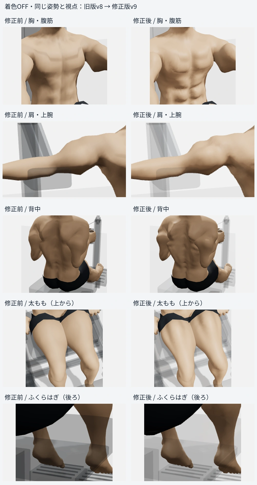

# 人体の筋別輪郭：TASK-053 ユーザー指摘による再修正

2026-11-17（日本時間）。起点は `c27cb4b`。過去のTASK-053のLGTM履歴は残すが、ユーザーの「厚みは出たが、筋肉がそれぞれくっきりしていない」という評価を優先して再オープンする。今回は写真で求められた筋腹の形・部位間の谷を、着色OFFの実表示で再レビューする。

## 実表示の比較



左は変更前v8、右は修正v9。いずれも正規Expo Webの実際のWebGLキャンバスを撮影したもので、形状の画像加工はしていない。同じ姿勢・視点・倍率・切り抜き範囲を使用。人体形状に加えて陰影・器具透過率も変更しているため、形状だけを切り分けた比較ではない。着色OFFで、胸・腹、肩・腕、背中、太もも、ふくらはぎを示す。座位で上を向く四頭筋は上方から、ふくらはぎは後方から確認する。

写真は前面・ポージング・背面の筋別形状の参考とし、写真と同一の人物・体格を再現したという判定はしない。現在も教育用のCG模型であり、写真相当の質感や実機性能は未検証。**テスト合格を見た目の受入に置き換えない。写真を見比べ、着色を消しても狙う筋を識別できるかを再判定する。**

## 変更した形状・描画

| 部位 | 表面の変更 |
| --- | --- |
| 胸 | 鎖骨側の筋腹と胸肋側の扇形、胸骨中央・脇への移行を再造形。旧版の広い暗い境界線を弱める。上部と中下部は大胸筋内の領域として扱う。 |
| 肩・腕 | 三角筋の下端をV字に絞り、上腕二頭筋・三頭筋の筋腹と境界、前腕への移行を造形。 |
| 腹・脇 | 腹直筋の平たい筋腹、腱画・白線の谷、腹斜筋・前鋸筋への移行を造形。 |
| 背中 | 僧帽筋・肩甲骨周囲・広背筋・脊柱起立筋の面と谷を造形。 |
| 脚 | 大腿直筋・外側広筋・内側広筋、ハムストリングス、左右に分かれる下腿後面の筋腹を造形。膝・足首へ細く移行する。 |

`human_anatomy_surface.py` は胴・四肢の皮膚にだけ曲面の共有辺頂点を追加する。13,905頂点/27,720三角形から **24,000頂点/47,910三角形** へ変更し、24,000頂点を上限とする。隣り合う三角形で辺頂点を共有し、T字接合を作らない。追加頂点は元の骨ウェイトを補間し、元と同じ上位4ウェイトに正規化する。筋腹・谷の造形後、6組のTaubin平滑化で局所的な角張りを緩和する。

人体メッシュは1個のまま。骨22本、基準姿勢、器具接点、元の顔・目・手・足の保護頂点/ウェイト/保護面を維持する。衣服の裾を水平に保ちながら、更新した皮膚からの間隔を再計算する。法線・AO・17領域マスクも再生成する。

形状が読めるよう、広い疑似境界陰影を胸0.22→0.04、他部位0.14→0.02へ弱め、AOを浅くする。肌の粗さは0.64→0.54、低い正面補助光と影のnormalBiasを追加。筋肉フォーカス＋器具透過時のみ器具不透明度を0.26→0.12へ下げる。他の透過表示は0.26、通常表示は1を維持する。

丸い胸の表面に追従するペックフライの収縮線が十分短くならない既存テストの失敗も修正した。通常の収縮線は変更せず、既存の強調モードだけ内側区間を少し短くする。これは学習用の線で、実際の筋束長・負荷の測定ではない。

全28種目の動作、握り、初心者/本格モード、記録、言語切替、50〜250%のカメラ操作を保持する。新しい依存・テクスチャ・アニメーション時計・保存フィールドは追加していない。

## 再生成と検証の考え方

元のCC0データ23入力・固定コミットを継続使用する。新しい人物モデルの取り込みはない。

```bash
python mobile/scripts/build-human-model.py \
  --source-root /path/to/makehuman \
  --output /tmp/makehuman-v9.json
cmp /tmp/makehuman-v9.json mobile/src/data/human/makehuman.json
python mobile/scripts/human_pectoral_masks.py --check
```

MakeHuman固定コミット：`a8bc2d54ff0ac92e78ff71431b1023eda42bf482`。Python/NumPyが必要。具体的な入力・ハッシュ・ライセンスはモデルJSONと同ディレクトリのREADMEに記録する。

テストは新しい頂点数に合わせるだけではなく、次を検証する。

- 新規4テスト：追加頂点付近の閉じた辺接続、保護された顔/手/足の位置・ウェイト・面、腹筋の実際の高さ差、胴の局所解像度。
- 骨・接点と元頂点の材料分類の固定ハッシュ、動作中の握り・接点誤差、全身の比率・衣服追従を維持。
- 頂点密度の変更で統計が偏らないよう、既存の筋量・深さ統計は元13,905頂点で比較。左右のマスクは頂点個数ではなく三角形面積を配分して比較する。旧版の生の個数差条件から、物理面積の左右差3%未満へ明示的に変更。
- 暗いAO頂点を多く要求する旧条件は廃止し、皮膚の平均明度245超、最小214以上、衣服/目255を確認。立体形状の検証と実画像で輪郭を評価する。

## 最終ソースの検証結果

- Jest：全63スイート / 772件合格（既存768件＋新規4件、388.443秒）。初回に見つけた収縮線1件の失敗は修正し、全体を再実行した。
- `tsc --noEmit`、`release:check`（日英2,032組・静的759呼出）合格。
- iOS / AndroidのHermesローカルバンドル各約6.5MBを生成。署名付きビルドではない。
- 固定CC0入力からのモデル再生成バイト一致、胸マスク再計算一致。
- 実Expo Web：日英（390/320幅）×全28種目×開始/終点×6方向＝672表示、実行エラー0。着色ON/OFFの往復一致、SVG切替、横はみ出しなしも確認。
- 比較用の着色OFF画像は変更前・変更後各14枚。ダッシュボードの51 DONE/3残と、TASK-053カード/モーダルも描画確認。

最終表示とアプリソースのsourceHash：`2180e5da6bd7bca242205d75b40428482c12d1c4f0c595a6be2d24f410724872`。

状態は **IN REVIEW（ユーザー指摘による再修正）**。以上は技術検証の結果であり、写真で求められた見た目の受入ではない。

## 性能と受入の限界

曲面の密度を上げたため、頂点処理・法線更新の仕事量は増える。24,000頂点の上限を設けたが、iPhoneでの実測FPS・発熱は未確認。Node/Jestの試計測は処理増加を示しており、速度向上という主張はしない。TestFlight、新規EAS/署名ビルド、外部配布は実行しない。

## Antigravityでの確認

古いプレビューを開き続けず、対象コミット取得後に正規Expoプレビューを再生成する。既存サーバーを停止してから実行する。

```bash
cd mobile
npm run preview:app -- --port 3000
```

`/app-preview/?lang=ja` と `?lang=en` を確認し、モデルのprofileが `anatomical-surface-v9` であることを照合する。初心者ガイドから詳細操作へ進み、筋肉着色OFFで胸/肩/腕/背中/腹/脚を確認する。前・横・後ろ・上から見て、開始/終点/途中の自然さ、握り、器具干渉、衣服、50%縮小も確認する。

写真で求められた区分が読めない、筋腹が不自然、動作時に崩れる場合は **Changes Requested** とする。TASK-053は見た目の再受入待ちであり、この実装報告でDONEへ戻さない。TASK-017/018および新規タスクは進めない。
