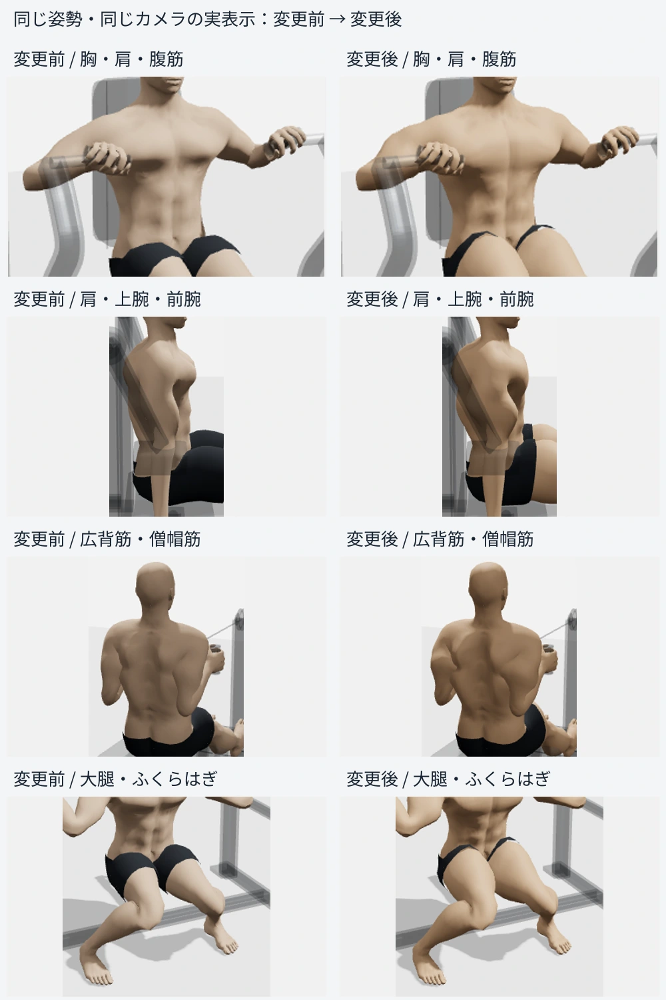

# TASK-052: 大会級の筋量と筋肉境界が見える人体模型

2026-11-17、日本時間。ユーザーの「各部位を自然にくっきり見せ、オリンピア級のボディビルダーをモデルに」と、追加された前面・ポージング・背面の写真3枚に対応。顔の同一性ではなく、筋腹の形と連続する体つきを参照する。

## 形状

人体を `bodybuilder-anatomy-v7` へ更新。特定選手のスキャンではなく、大会ボディビルの筋量・部位分離を参考に、固定CC0素材から独自に造形している。

- **胸**：鎖骨下の上胸部から脇へ続く広い扇形。局所的な丸い突起や、平面を急につないだ棚形を避け、浅く丸い筋腹へ連続的に補間する。胸骨正中線と上下の浅い境界を保つ。
- **肩・腕**：外側の丸い三角筋、二頭筋/三頭筋の筋腹、肩の付着部の浅い分離、前腕の厚み。肘と手首へ細くつなぐ。
- **背中**：広背筋の厚みと側面の張り、肩甲骨周辺と僧帽筋の立体感。腰の中央へは量を足さず、自然な姿勢を維持。
- **腹**：球形の粒ではなく、角の丸い平たい左右の筋腹。中央・横の浅い境界と外腹斜筋の起伏。
- **脚**：四頭筋/ハムストリングスの筋量、内側の膝上の膨らみ、ふくらはぎの後方の筋腹と浅い分離。脛前面は抑え、膝/足首を膨張させない。
- **衣服**：同じシェルのショーツを短くし、四頭筋の見える範囲を増やす。腰/股間の被覆は保ち、実表面から支持点を再計算する。

温かい肌色と粗さ0.64の控えめな反射で、動作中の面の向きを見分けやすくする。

造形は実際の頂点を動かし、法線・17部位の学習マスク・衣服支持・幾何学由来の陰影をまとめて生成。着色OFFでも形状と陰影で見分けやすくし、ONでは狙う部位の色/筋繊維が同じ表面へ追従する。

## 実際のプレビュー比較

左が変更前（v6）、右が変更後（v7）。同じ種目・姿勢・視点・倍率で着色をOFFにした、実Expo Webの描画を切り出して並べたもの。人物を画像で置換したものではない。



写真と同じ人物・完全な写実性の再現を保証するものではない。ユーザーの見た目の受入は別途必要。

## 保持したもの

同じ23個の固定CC0入力、13,905頂点/27,720三角形、22骨、トポロジーと素材分類、静止骨格・握り基準・手3,094頂点、衣服以外のスキニング重みを保持。関節体積のスキニング、全28種目の軌道・器具・手足接点、カメラ/速度/再生と既存記録は変更しない。衣服支持点と重みは新形状へ再生成。

筋量の係数は造形用で、実測の筋肉量ではない。着色は種目の対象部位であり、筋張力・活動率を測定していない。本格モードの収縮解説非表示と本格専用記録（TASK-050/051）は維持。依存、メッシュ数、実行時テクスチャ、アニメーション時計の追加なし。

## 検証済み

- 全60スイート/760テスト（新規8件・既存752件）。骨格/握り/関節端、左右の筋腹、衣服/全28種目の接点、ベンチ、陰影範囲を確認。
- 型検査、日英2,029組/静的758呼出の監査、release:check、両OS Hermesローカルバンドル各5.5MB成功。
- 固定CC0入力からの再生成がバイト一致。胸の学習マスク再計算も一致。
- 実Expo Web/Chromiumの28種目×日英（幅390/320）×開始終了×6方向=672表示で実行エラー0。着色ON/OFF、図解、横はみ出しも確認。
- 同じ実表示で360度24段階、上下回転、再生/停止を確認。比較画像は着色OFF。写真のように見えるかの判定を自動テストで保証するものではない。

検証対象のアプリsourceHash: `6be747fed5057ccd9fb8e57442633f366cd5ba1a4b49afe0107dfe0f804099a1`。iPhone実機は未確認。

## 再現・レビュー

```bash
PYTHONDONTWRITEBYTECODE=1 python mobile/scripts/build-human-model.py --source-root /path/to/pinned-makehuman --output /tmp/reproduced.json
cmp mobile/src/data/human/makehuman.json /tmp/reproduced.json
```

入力MakeHumanの固定コミット: `a8bc2d54ff0ac92e78ff71431b1023eda42bf482`。素材リストとSHA-256はJSONのsourceに記録。変換時に入力ファイルの変更とコミットを検証する。

```bash
git pull --ff-only origin main
cd mobile
npm run preview:app -- --port 3000
```

古い3000番プレビューは停止して再生成し、`/app-preview/?lang=ja` と `?lang=en` で確認する。

1. チェストプレスの前面/横/上方で、胸上部と肩の境界、上腕の厚みを確認。
2. ロー/ラットプルを後ろから見て、広背筋・肩甲骨・肩/腕の分離と自然な腰のつながりを確認。
3. スクワット/脚種目で、四頭筋・ふくらはぎ、ショーツの裾と股関節/膝の動きを確認。
4. 着色OFFで輪郭、ONで対象部位を確認。開始/終了、360度/上下、低速/停止で不自然な膨張や衣服/器具との干渉がないか確認。
5. 本格モードは模型を開いて同じ人体が使われ、収縮理論の解説が復活しないことを確認。

状態はIN REVIEW。ユーザー/Antigravityの見た目の受入とiPhone実機は未確認。TestFlight・新規EAS/署名ビルド・外部配布は行わない。
