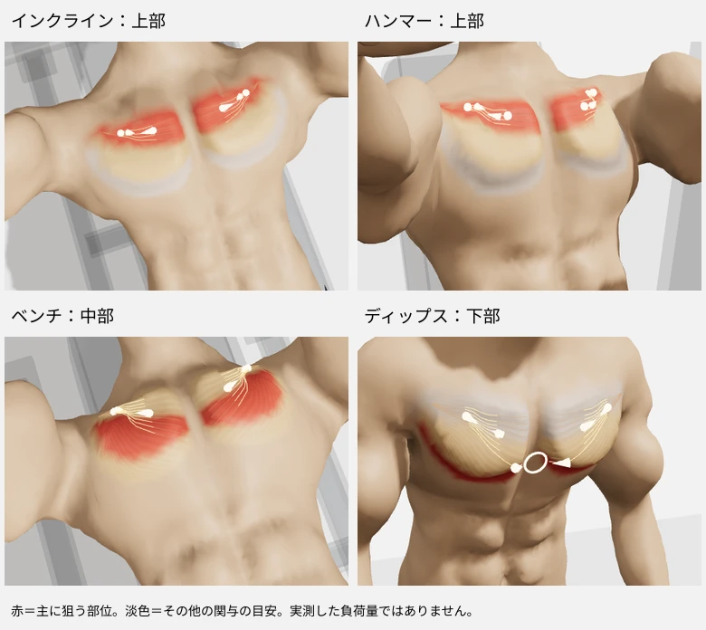

# 種目ごとの胸上部・中部・下部の狙い（TASK-056）

2026-11-19、日本時間。起点main `5756620`。ユーザーの明示依頼は、インクライン2種の上胸部の狙いと具体的なセットアップ/動作を反映し、これまでの赤い対象筋表示をもっと細かくすること。実装対象はアプリ本体 `mobile/src/`。他タスクや配布には進まない。

正規Expoアプリの動作終点を撮影し、胸が見える部分を切り抜いて配置。上段はインクラインベンチとインクラインハンマー、下段は通常ベンチとディップス。仰向け種目は上方、ハンマー/ディップスは前方の実カメラ。人物・器具・着色を画像加工で描き換えていない。

## 見え方の変更

従来は上部を金色、胸肋部を赤で識別しており、種目ごとの狙いが伝わりにくかった。今回は主に狙う領域を赤、そのほかの関与を淡色とする教材用の設定へ変更。

| 種目 | 上部・鎖骨側 | 中部・胸骨側 | 下部・肋骨側 |
|---|---|---|---|
| インクラインベンチ / インクラインハンマー / インクラインダンベル / 旧スミス | 主に狙う | 一緒に働く | 主な狙い以外 |
| 通常ベンチ / 標準設定のチェストプレス | 一緒に働く | 主に狙う | 一緒に働く |
| ディップス | 主な狙い以外 | 一緒に働く | 主に狙う |
| ペックフライ / スーパーフライ / ケーブルクロス | 主に狙う | 主に狙う | 主に狙う |

これは標準フォームでの狙いの目安。中部/下部は連続する胸肋部を説明のために分けたもので、別々の筋肉ではない。姿勢、機種、角度、個人差で関わりは変化する。「その他の関与」は働かないという意味ではなく、赤い面積・色の濃さを実測負荷、筋活動、効果の割合とは扱わない。均等な負荷や完全分離を保証しない。

3Dの皮膚に上部/中部/下部の滑らかな座標を一度計算し、種目別の色を同じ頂点へ与える。画面の上/下に帯を貼る処理ではないため、横・上方・回転・動作中も人体に追従する。色の配列は種目切替時に更新し、同じ対象筋を使う通常ベンチ/ディップス/フライ間でも前種目の色が残らない。

模型の直下に3領域と役割の凡例を追加。既存の鎖骨部/胸肋部への拡大ボタンは拡大専用として維持し、識別用の金色の点は取り除いた。初心者の対象部位図、動く筋線維の補助図、SVG代替図解も同じ種目別設定を使う。本気モードは短い対象部位表示のみとし、筋収縮の詳しい説明を増やさない。

## インクラインの具体的な助言

初心者の準備/手順、動作と戻しに同期するキュー、意識/間違い/修正、設定欄を日英で整合。

- ベンチは30〜45度を目安に、バーが鎖骨の少し下の上胸部へ来るよう前後位置を合わせる。
- 肩甲骨を軽く寄せ、背中・お尻・足の支持を保つ。胸の張り過ぎや腰の過伸展を避ける。
- 戻しは2〜3秒。胸にぶつけず、触れる手前を目安に痛みのない範囲で切り返す。無理に深さを強制しない。
- 押す時に肩を耳へ近づけず、背中の支持を保って上胸部を狙う。肩がすくむ場合は負荷を軽くする。
- ハンマーは座面高とグリップを上胸部へ合わせる。固定式の背もたれへ30〜45度調整を強制しない。

30/45度の比較図は既存の説明用機能。動くスミス模型は既存の30度基準・バー軌道を維持し、比較図の選択で3D姿勢が変わったとは扱わない。本格側の助言は負荷位置と制御に絞り、初心者の基本説明を本格専用パネルへ追加しない。

## 保全と検証

- v12の人体データ、輪郭・陰影用法線・胸下端補正、骨格、握り、器具機構、全29種目、保存形式を変更していない。
- 胸9種目×開始/中間/終点の実3D頂点位置/法線のSHA-256は、変更前mainと同一：`0a1dca671a4b51d209d933ac852b1c6e24d74a5163732262ebfa8caa814a9b14`。
- 既存の色テストは「いつでも上部が金色」という旧仕様から、今回依頼された種目別の色の関係へ更新。形状・握り・着色OFFの保全条件は維持。
- 関連5スイート35テスト・型検査・release:check（日英2,085組/762静的UI呼出）合格。主役の領域が他領域より赤いことを実頂点の色で検証し、種目切替と動作中の再現性も検証。
- 正規Expo：胸9種×3姿勢×2方向×日英＝108表示。凡例/SVG各18通り、着色ON/OFF復帰、英語混入なし、320/390幅の横はみ出しなし、実行エラー0。
- iOS/Android Hermesローカルバンドル各約6.6MB成功（署名ビルド・配布ではない）。
- 全体66スイート817件を実行（505.281秒）。65スイート816件合格、英語のメニュー→Smithガイド→記録→復帰の1件が5秒でタイムアウト。コード・期待値・時間制限を変えず該当expandedChestスイート6件を単独再実行し全合格（5.385秒）。単一の全体実行で全緑だったとは記録しない。

検証sourceHash：`cef5f81e4c8a2d1d90b5aeed3d7717a6cb26602b2dfa16c663089d8011118d0f`。

## 再レビュー

最新mainを取得して旧プレビューを止め、`cd mobile && npm run preview:app -- --port 3000` で再生成。`/app-preview/?lang=ja` / `?lang=en` のmetadata sourceHashを照合する。

胸の種目を切り替え、上部/中部/下部のどこが赤くなるかを開始・途中・終点、前/上方/横/自由回転で確認する。凡例・初心者の部位図・SVG代替でも同じ狙いを確認し、インクラインの4ステップ・設定・戻し/押しのキューを照合する。着色を消すと元の自然な肌へ戻り、形と握りは変わらないこと、本気モードに基本/収縮の詳説を増やしていないこと、記録が保持されることを確認する。

状態は **IN REVIEW** で、見た目の受入はAntigravityへ依頼する。ブラウザ検証をiPhone反映済みと案内しない。新規EAS/署名ビルド・TestFlight・外部配布は未実行。実機の速度/発熱とアプリ更新は引き続き未確認。
