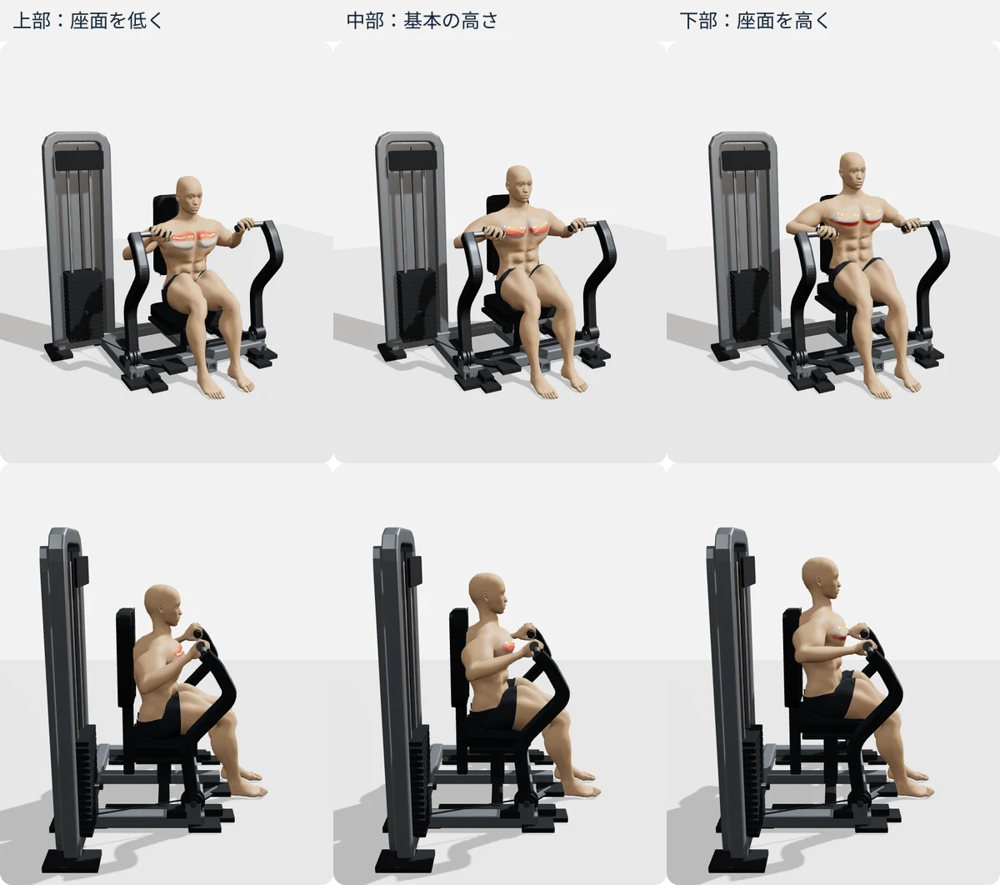

# TASK-060：チェストプレスの3高さ・人体・胸の領域表示

アプリ本体のチェストプレスに「上部・座面を低く」「中部・基本の高さ」「下部・座面を高く」の切替を追加しました。座面比較図のボタンとも双方向に連動します。

- 上部：座面を下げ、グリップが鎖骨の少し下に来る関係を表現。模型の上体はわずかに前傾し、上部のみ赤く強調。
- 中部：基本位置で胸の中ほどにグリップを合わせ、中部を赤く強調。前腕は押す方向へそろえ、肘は肩より少し低くします。
- 下部：座面を上げ、グリップが乳頭線付近〜やや下に来る関係を示し、下部を赤く強調。

赤は選んだ教材上の狙いを示す定性的な表示です。実測の負荷分布や、座面だけで特定部位へ確実に効くことを表すものではありません。器具の押す軌道、体格、肩・腕の角度で関与は変わります。鎖骨の高さを無理に作ったり、背中を支持面から大きく離す前傾を勧めない説明を日英で併記しました。

## 模型と表示の整合

マシンの支点・ハンドル軌道は3パターンで同一。座面・人体の高さを変え、手を固定軌道に逆運動学で合わせます。腕の骨長とハンドル把持、足の位置を保全。模型の各位置は相対的な設定で、実機の座面番号・寸法を保証する値ではありません。

3パターンの見本は共通して基本軌道の90%を使用し、どの高さでも肩・肘を伸ばし切らず届く範囲を示します。選択肢のない既存の基本フレームと、ほかの種目の軌道は変更していません。設定変更時は再生を止めて開始位置に戻します。

赤い部位は実際の3D人体の上部・中部・下部の座標重みに基づいて切替。凡例・対象部位の見出し・軽量SVGの3領域・動作矢印も同じ選択を参照します。色のキャッシュとカメラの範囲も設定別に更新し、切り戻し時の表示残りを防ぎます。人体アセット・筋肉マスク・記録形式は変更していません。

## 確認手順

1. 最新mainで `npm --prefix mobile run preview:app` を実行し、`/app-preview/?lang=ja`で初心者ガイドを開く。
2. チェストプレスの3つの部位ボタンを切替。横から座面と人体、正面・上方から胸の赤い領域を確認。
3. 開始・終了の手動表示と0.25倍再生を確認。全設定で手がグリップに留まることを確認。
4. 座面比較図を開き、低い・標準・高いを選び、模型と部位選択も更新されることを確認。
5. 軽量図解と英語モードでも同じ設定が反映されることを確認。

新規6テスト：3姿勢の座面/固定軌道/骨長/握り/足、3領域の実頂点色と切り戻し、日英UI操作を検査。関連する既存の座面ガイド4テストも合格。全70スイート/842テスト合格（実行時`--testTimeout=15000`）。型検査・release:check・両OSローカルバンドル成功。日英36表示・比較図連動・低速/SVG確認でエラー0。実機更新・EAS署名ビルド・TestFlight・外部配布は保留しています。
