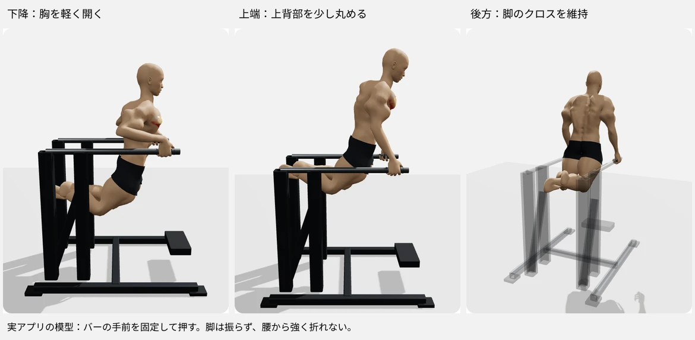

# ディップス：手前握り・脚クロス・胸を開く下降と上背部の丸め（TASK-057）

2026-11-19、日本時間。起点main `68d50ac`。ユーザーの明示指示「バーの手前を持つ」「脚はクロス」「少し胸を張って伸びを感じながら降ろす」「上がる時は少し猫背になる意識」を、アプリ本体の人体模型と日英教材へ反映する。

正規Expoアプリの実描画。左/中は同じ側方カメラの下端/上端、右は上端の後方視点。撮影画像の縮小・配置・外側の文字以外に、人物や器具を加工していない。

## 変更した動作

- **バーの手前**は既存の踏み台に近い前側と定義。バーの前端より5モデル単位内側を握り、グリップ全長6単位の外にも余裕を残す。人体も同じ方向へ移し、手を同じ世界座標に固定したまま腕の長さを保って上下する。
- 把持位置へ支柱が重ならないよう、支持を後方へ配置した平行棒構造へ整理。バー、握り、支持枠、踏み台は全動作で固定。新しい器具の正確なメーカー製品複製ではない。
- **脚は足首付近でクロス**。左脚の足首は体の右側、右脚は左側へ。左右の奥行きと高さをずらし、同じ座標へ足を重ねない。股関節・膝・足首の相対姿勢を保ったまま、体と一緒に上下する。太もも20/下腿21の既存長を維持。
- **下降では胸を軽く開く**。下端で上胸郭を軽く開き、中間へ滑らかに戻す。模型の上背部角度は説明用に最大4度の伸展とし、腰や下背部の向きを変えて反らさない。
- **上昇終盤では上背部を少し丸める**。進捗65%以降で滑らかに丸め、上端では説明用に最大12度。首は上背部の向きへ追従し、頭だけ前へ突き出さない。旧8度の終盤動作を更新した。
- 上下の可動域（骨盤43〜57.8）、腕の長さ、既存の胸下部の狙い・着色、手指の握り、筋線維ガイド、低速/手動/カメラ・記録を維持。角度値は模型用で、人へ同じ角度を強制する処方ではない。

初心者は既存どおり上の支持姿勢から開始し、1回再生で下降→上昇する。手のステップは手前握り、足のステップはクロスを示す。動作/戻しのキュー、上端の助言、設定/注意点/意識/コツ、本格側の負荷位置の短い助言も同じ方法へ更新した。肩をすくめず、腰から強く折れず、肩に痛みのない可動域を使う。補助付き機種は足のクロスを一律に強制せず、実機の支持方法を優先する。

## 回帰・保存

`chest-dip` の既存IDと記録名はそのまま。追加重量の記録規則、保存スキーマ、言語設定、他28種目を変更しない。

前回の「胸9種目の全頂点位置/法線が不変」というテストは、今回ユーザーが動作変更を指定したディップスだけを対象外へ更新。残る胸8種目×開始/中間/終点は変更前と同一のSHA-256 `c26549bd14e2a91823209888fa2076819f8e6e74f12fd90a07b1e4496656aa49` を検証し、ディップスは新たな固定握り・交差・骨長・脊柱の向き・手指接点・連続性のテストで検証する。旧の終盤曲率テストも、下降側の4度の開きと上端12度へ仕様更新し、骨長や腰の安定などの条件を維持。

## 検証

- 関連5スイート59テスト、型検査、release:check（日英2,085組/762静的UI呼出）合格。
- 正規Expo：日英×4段階×6方向＝48表示。手/足の初心者ステップ、0.25倍実再生、手動操作、SVG代替、英語混入なし、320/390幅の横はみ出しなし、実行エラー0。
- 全67スイート822テスト合格（既存817＋新規5、520.961秒）。
- iOS/Android Hermesローカルバンドル各約6.6MB成功。署名ビルド・配布ではない。
- sourceHash: `51684de0ada20b0406a5011e7ed71ad32b81c4e356cdd1e7c4196e49ef0508cc`。

## 再受入

最新mainを取得し、旧プレビューを止めて `cd mobile && npm run preview:app -- --port 3000` で再生成。`/app-preview/?lang=ja` / `?lang=en` とmetadataのsourceHashを照合。

胸コースのディップスを開き、手→足→動作を確認。前・側方でバーの前寄りの固定握り、後方で脚の交差を確認する。低速または手動位置で、下降の胸の開き、上昇終盤の上背部の丸め、腰と首の安定、動作中の握りの維持を確認。戻す方向でも滑らかにつながることと、重量/回数/セット記録・言語切替・他の胸種目が維持されることを確認する。

状態は **IN REVIEW** として見た目の受入を依頼する。実機インストール・速度/発熱は未確認。新規EAS/署名ビルド・TestFlight・外部配布は未実行。他タスクは進めない。
