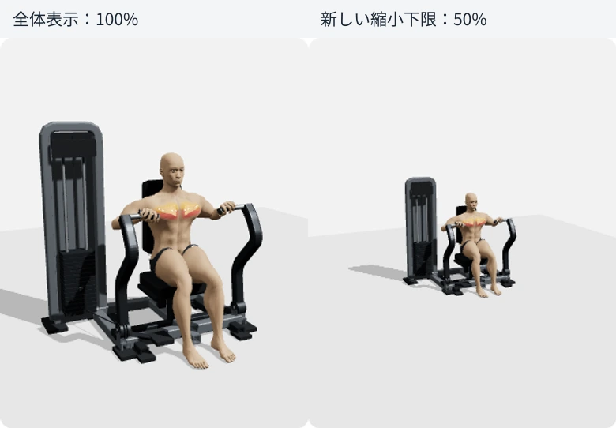

# TASK-054: フォーム模型の縮小範囲

2026-11-17、日本時間。縮小下限を100%から50%へ広げた。上限250%、初期115%、全体表示100%、ボタンの15ポイント刻みは維持。日本語ラベルは「表示倍率」。

ボタン・ピンチ・描画が共通の制限関数を使う。部位拡大中も縮小でき、焦点やフォームの位置は維持する。人体と器具の全体を入れる際は、既存の全体表示ボタンで全体フォーカス/100%へ戻せる。ピンチは回転解除モードで使用する。

## 検証

- カメラ関連7テスト成功。全28種目/4自由視点で50%のクリップなし、姿勢バッファ再利用、日英の下限/上限/復帰/部位拡大中の縮小、ネイティブのピンチを確認。
- 型検査、release:check、両OS Hermesローカルバンドル各5.5MB成功。全768件は再実行せず、変更に関連する既存テストを更新・実行した。
- 実Expo Webで日英/390・320幅×28種目=56状態。実ピクセル上の縮小と50%停止、65%拡大、100%/115%復帰、横はみ出し/実行エラー0を確認。

検証対象sourceHash: `1ad27f2176769854cb455d1fd12c68793305259d3010a02f89486c3fc5613b6d`。人体/器具/動作/記録/依存は変更していない。iPhone実機確認は未実施、状態はIN REVIEW。

## 再表示

最新main取得後、古いサーバーを止め、`cd mobile && npm run preview:app -- --port 3000` で再生成する。`/app-preview/?lang=ja` と `?lang=en` で「縮小」を押し、50%まで下がることを確認する。TestFlight・新規EASビルド・配布は行わない。
