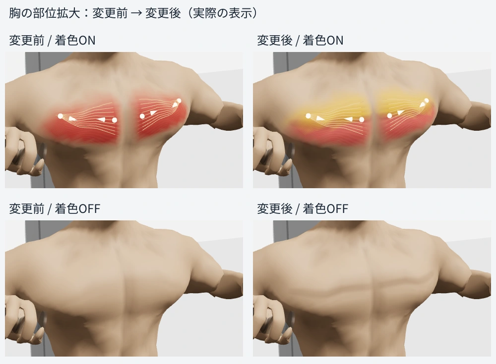

# TASK-053: 胸上部/中下部と筋肉の境界を明瞭にする

> 履歴（v8）：ユーザーが見た目を未達と指摘したため、TASK-053は再オープンしました。現行のv9曲面造形と着色OFFの比較・受入基準は [人体の筋別輪郭の再修正](ANATOMICAL_SURFACE_REWORK.md) を参照してください。以下の頂点数・比較画像・検証結果は旧版の記録です。

2026-11-17、日本時間。TASK-052の筋量追加後も「くっきりしておらず分からない」というユーザーの指示に対応。今回の範囲は部位を見分ける表現と、その部位を近くから見る操作。

## 変更

- `regional-definition-v8`：上胸部と胸肋部の間に、鎖骨/脇のランドマークに沿う浅い斜めのくぼみを造形。法線・部位マスク・AOを再生成。v7の骨格・手の握り・全身の筋量を維持。
- 肌表面の定義フィールドを静止形状から作り、人体と同じ面に追従させる。胸の斜め境界と肩/腕/背中/腹/脚の部位マスク境界に陰影を加え、着色OFFでも輪郭を読めるようにする。
- 胸種目では黄を上部（鎖骨部）、赤系を中・下部（胸肋部）の識別色にする。上部を狙う種目でも隣接する胸肋部を淡く識別できる。従来の対象マスクだけが動作の変形とtint属性を制御する。
- 3Dの模型直下に、48ポイント以上の部位名ボタンを表示。タップで既存の部位拡大・器具透過を利用し、立位/座位は前から、ベンチは上方から見る。色OFF/SVG表示では非表示。日英対応。本格モードに筋収縮の理論解説は追加しない。

大胸筋は連続した筋肉であり、この境界は学習用の簡略表現。独立した二つの筋肉や、上下の完全な種目分離を意味しない。色は部位識別で、実測の筋力/活動率ではない。胸肋部を含む全胸領域への拡大は既存の`chest`ターゲットを利用する。

## 実表示の比較

同じチェストプレスの開始姿勢、前方視点、部位拡大での比較。上段が着色ON、下段がOFF。実Expo Webの画面を切り出して並べたもので、人物画像による置換ではない。

## 保持

13,905頂点/27,720三角形、22骨、17部位、同じ23 CC0入力、握り、全28種目の軌道と器具、水平ベンチ、記録/端末保存、本格/初心者分離を保持。追加は静的な1属性と既存材質の陰影処理で、新規メッシュ・時計・テクスチャ・依存なし。部位ボタンは軽量な色定数だけを参照し、人体データやThreeをUIへ追加ロードしない。

## 検証済み

- 全62スイート/768テスト。新規8件で上下の色差・5種目/3局面・手接点と位置保持・日英の簡単/詳細での部位選択・非表示を検証。既存760件も維持。
- 型検査、release:check（日英2,032組/静的759呼出）、両OS Hermesローカルバンドル各5.5MB成功。
- 固定CC0入力からの再生成と胸マスクの再計算が一致。
- 最終ソースの実Expo Webで28種目×日英（390/320幅）×開始終了×6方向=672表示。着色ON/OFF、図解、横はみ出しも確認し実行エラー0。
- v7の変更前と最終版日英の3構成で比較・上下の部位名タップ・選択状態・着色OFF/図解時の非表示を実確認しエラー0。

両表示検証とアプリソースのsourceHash: `938f4ca50d4f2685b3a1a23f0a1396167d4d3b66b5e696c872ad363cc7d33d37`。状態はIN REVIEWであり、ユーザー/Antigravityの見た目の受入とiPhone実機は未確認。

## 再現・レビュー

`build-human-model.py`の固定入力から再生成できる。以前の形状ピンのダイジェストとprofileをv8へ更新。浅いくぼみで上胸部の平均厚みがわずかに減るため、v6からの増分下限を0.10→0.08へ変更し、上限と他部位/関節端/手の固定条件は維持。

1. 最新mainを取得し、旧プレビューを止める。
2. `cd mobile && npm run preview:app -- --port 3000` で再生成する。
3. `/app-preview/?lang=ja` と `?lang=en` でチェストプレス/ペックフライ/インクライン/ベンチを見る。
4. 着色ONで上下の識別、OFFで境界、部位名タップで拡大と透過を確認する。
5. 開始/終了/低速、前/横/後ろ/上下で境界が浮いたり器具や握りが変わらないか確認する。

見た目の受入とiPhone実機確認は別途必要。TestFlight・新規EAS/署名ビルド・配布は実施しない。
