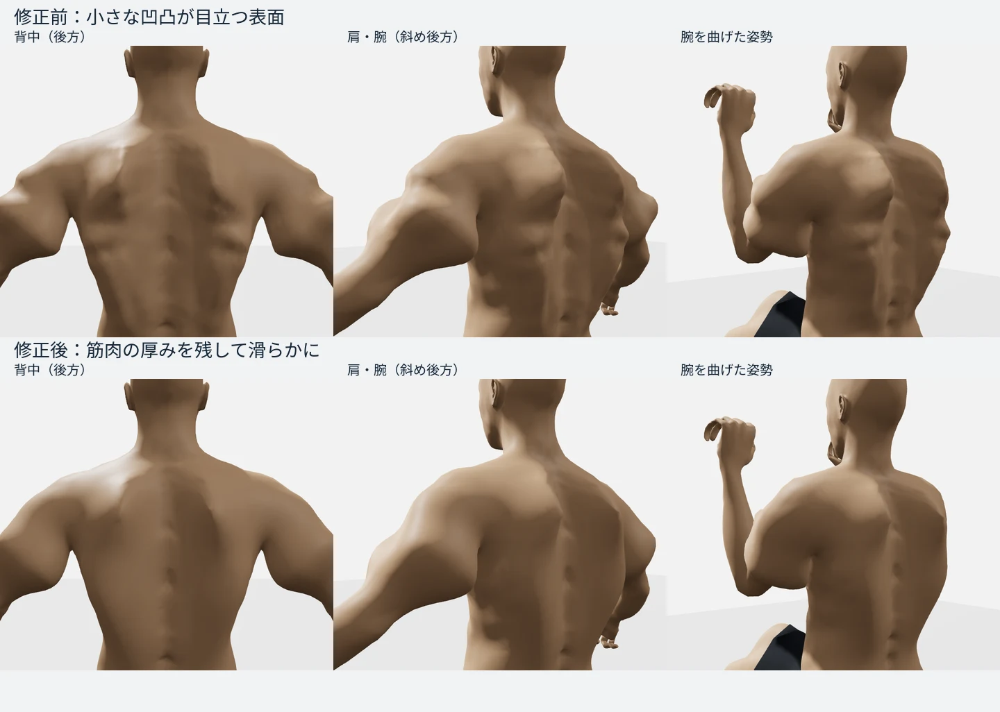

# TASK-058：腕・背中の自然な筋肉輪郭（レビュー依頼）

ユーザー提供の横向き／背面写真を参考に、アプリの動く人体模型で目立っていた腕・背中の小さな凸凹を減らしました。肩から上腕、肩甲骨から広背筋へ続く大きな筋腹を残し、部位の境界が連続して見えるようにしています。

比較は正規アプリと同じ人体・変形・描画コードを使い、修正前（main `759003b`、v12）と修正後（v13）を同じ姿勢・カメラ・照明で描画したものです。比較用の撮影では器具を隠し、着色を切っています。見た目の最終受入はAntigravityとユーザーの確認待ちです。

## 変更範囲

- 上腕・前腕：局所的に飛び出す小さな山や細い溝を均し、二頭筋・三頭筋・肩の大きな厚みを維持。
- 背中：肩甲骨まわりと広背筋の短い段差を整え、背骨の正中線と左右に広がる輪郭を維持。
- 細い溝に出ていた強い陰影も同じ範囲で調整。照明・肌素材の設定は維持。
- 胸・頭・手・脚・衣服など、修正範囲外18,901頂点の位置・法線・陰影データはv12と完全一致。
- 24,000頂点／47,910三角形／22骨／人体メッシュ1個、全筋肉マスク、骨格・スキニング重み、器具・握り・衣服追従・動作軌道・記録方式は維持。

生成処理は`mobile/scripts/human_arm_back_surface.py`のオフライン局所曲面処理です。実行時のメッシュ・テクスチャ・更新ループは増やしていません。肩甲骨の密な面は向きが反転しないよう局所的に補正量を制限しています。

## 形状の確認

| 対象 | 隣接法線の細かな変動・修正前 | 修正後 |
| --- | ---: | ---: |
| 右腕 | 0.05013 | 0.02717 |
| 左腕 | 0.05078 | 0.02744 |
| 背中 | 0.04495 | 0.01534 |

数値は肌表面の小さな段差を見る補助指標です。筋肉の活動量や医学的な正確さの測定値ではありません。背中の平均厚みは元の99.86%、腕の前後方向の広がりは97.6%以上を維持しています。面の反転は0件。部位の厚み・輪郭を保持した局所修正です。

既存の全身固定ハッシュは、今回変更する腕・背中を除く保護頂点へ範囲を限定しました。期待値は新しいモデルから取得せず、承認済みv12から再計算しています。別途、変更範囲の元座標を保持したfixtureで面の向き・補正量・厚みを検査します。上腕・前腕の影響が重なる肘は、関節全体の保護窓で元の輪郭を保ちます。胸の輪郭・下縁の連続性・握りなど既存の数値基準は維持しています。

## Antigravityでの確認

1. 最新mainを取得し、`npm --prefix mobile run preview:app`を実行。
2. `http://localhost:3000/app-preview/?lang=ja`で「はじめてのマシンガイド」を開く。
3. ラットプルダウン／シーテッドケーブルロー／アームカールマシンを選択し、「視点・再生の詳しい操作」へ。
4. 筋肉の着色を消し、正面・左右・後方から肩と上腕のつながり、肩甲骨・広背筋の面を確認。開始／途中／終了で比較。
5. 着色を戻して0.25倍再生と手動位置操作を確認。胸のプレス・フライ・ディップスも選び、胸の形と手の握り、脚クロスなど既存動作を確認。
6. `?lang=en`でも同じ画面を確認。

プレビューはネイティブアプリのソース確認用です。iPhoneに入っているアプリへ自動更新はしていません。TestFlight・新規EASビルド・署名・配布は保留を継続しています。

## 検証記録

- v12・v13とも、固定されたCC0入力からの再生成結果が保存モデルと完全一致。胸のマスク再検証も一致。
- 関連6スイートの対象81件を確認（既存75件＋新規6件）。広がり・厚みを検査する新規6件は合格。
- TypeScript型検査、日英2,085組／762静的UI呼出を含む`release:check`合格。
- iOS／AndroidのHermesローカルバンドル生成成功（各約6.6MB）。署名ビルド・配布は実行していません。
- 同じ描画コードの近接比較：開始／中間／終了・前方／斜め後方／後方など、修正前後計114表示で実行エラー0。
- 正規Expoアプリプレビュー：ラットプルダウン・ロー・カール・ディップスを日英／390・320幅×着色ON/OFF×3姿勢×3方向＝144表示で確認。0.25倍実再生、手動位置、英語文字分離、画面幅を超えないことも合格。実行・コンソールエラー0。
- sourceHash: `499c61bdc4672fa6437f2f528e1d37a9f4aac9a5a16407c492d446264fe375d6`
- [機械可読の表示・形状証跡](evidence/natural-arm-back.json)

全68スイート／828テスト合格（既存822件＋新規6件、実行時`--testTimeout=15000`指定）。見た目の最終受入とiPhone実機での表示・速度は未確認です。

既存の画面操作テストは、全体実行時の5秒タイムアウトで4件が時間切れになったため、実行時の時間枠を15秒にして検証しています。肘の既存固定基準は元の形に戻して維持し、画面操作テストの本体・期待値は変更していません。
