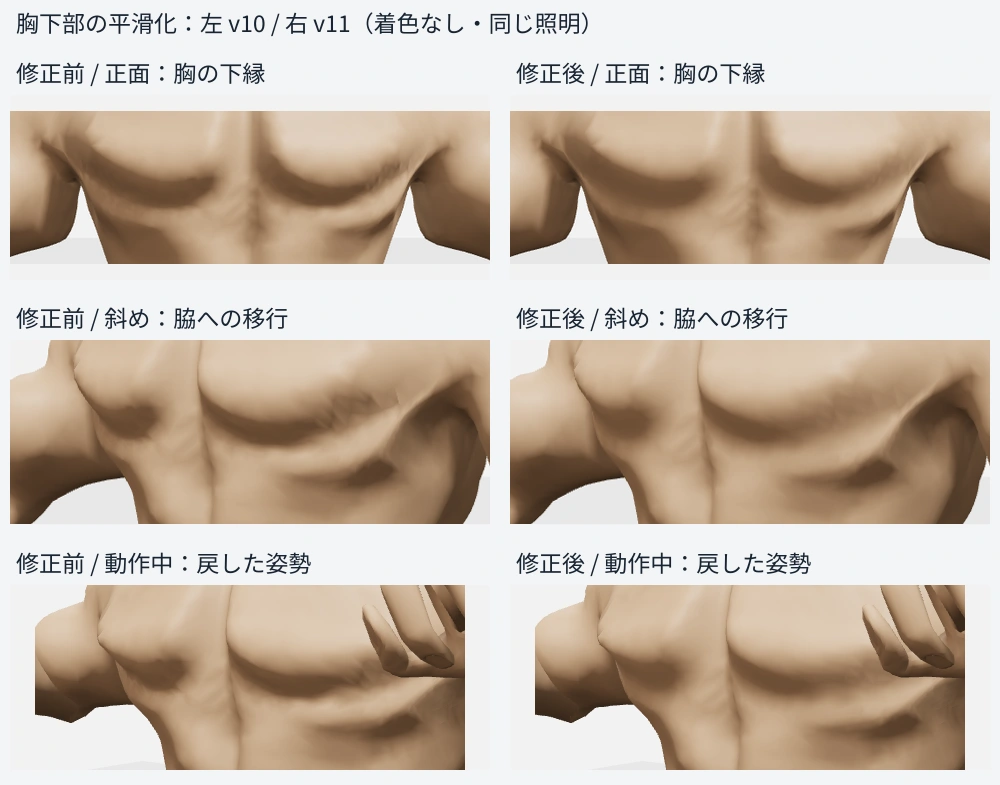

# 胸上部・中部を保ち、下縁だけを平滑化（TASK-053）

> 続報：赤い胸筋の下の大きなくぼみは別途残っていたため、最新修正・再受入対象は[胸郭への移行修正（v12）](SUBPECTORAL_TRANSITION.md)。以下はv11の履歴。

2026-11-18、日本時間。起点はmain `13fd0ed`（モデルは `240891e` のv10）。ユーザーが胸筋の上部・中部を評価し、下部の凸凹のみを修正依頼した。新タスクは作らず、TASK-053の下縁修正として扱う。

## 実表示の比較



左がv10、右が `photo-pectoral-lower-smooth-v11`。同じ人体・スキニング・照明・材質・視点・倍率で、着色OFFの実モデルを撮影した。器具を非表示にした検査画像で、画像の人物形状を加工していない。上2段は基準姿勢の正面/斜め、下段はチェストプレスの戻した姿勢。正規Expoアプリでも別途確認する。

## 変更

`smooth_lower_pectoral` が下縁と直下の肋骨への移行にだけ作用する。近くの皮膚頂点に局所二次曲面を当て、深さの微小な段差と、その微分から求めた法線を滑らかにする。修正量は1頂点あたり最大0.051モデル単位。位置が変わるのは478頂点、法線483頂点、AO146頂点。曲面の適用範囲は筋腹の頂点より下で滑らかにゼロとなる。

胸上部・中部を含む23,488頂点の位置・法線・AOはv10とバイト一致する。上胸部の学習マスクも全て一致。全胸マスクは既存の近傍処理により保護領域内の6頂点が最大1/255変化するが、上部・中部の形状/法線/陰影は変わらない。

下縁の法線と近傍平均の差は平均0.07185→0.03165、最大0.16789→0.10359。これは面の陰影の連続性を見る指標で、筋活動・負荷・解剖学的な正確さの測定ではない。数値だけで見た目を合格にしない。

以下を維持する。

- 全X/Y座標、24,000頂点/47,910三角形、1人体メッシュ。
- トポロジー・材料・全スキンウェイト、22骨・基準骨格・握り・衣服接点。
- 胸の輪郭・筋腹・中央の溝、照明・材質・収縮係数・筋繊維ガイド。
- 全28種目の動作、初心者/本格モード、記録、言語、50〜250%ズーム。

生成時だけNumPyで処理し、フレーム毎の処理や新しい依存・時計・保存項目は追加しない。シェーダーのキャッシュ識別子とモデルprofileをv11へ更新する。

## 検証方針

`pectoralShape.test.ts` に2件を追加。v10の保護領域のバイナリ固定値で上部・中部の保全を確認し、実メッシュの近傍法線のばらつきに上限を設ける。既存の輪郭・左右差・骨格/握り/ウェイト・衣服テストは保持し、意図した生成データの固定ダイジェストとprofileだけを更新する。既存の許容範囲は緩めない。

```bash
python mobile/scripts/build-human-model.py --source-root /path/to/makehuman --output /tmp/lower-smooth-v11.json
cmp /tmp/lower-smooth-v11.json mobile/src/data/human/makehuman.json
python mobile/scripts/human_pectoral_masks.py --check
```

固定CC0入力は従来と同じ23個、コミット `a8bc2d54ff0ac92e78ff71431b1023eda42bf482`。

## 最終検証結果

- 関連3スイート49件、その後の全体再実行で64スイート779テスト合格（既存777＋新規2、379.741秒）。
- TypeScript型検査、release:check（日英2,032組/静的759呼出）合格。
- 固定入力からのモデル再生成バイト一致、胸マスク再計算一致。
- iOS/Android Hermesローカルバンドル各約6.5MB成功。署名ビルド・配布ではない。
- 正規Expo：胸8種目×日英（390/320幅）×開始/終点×6方向＝192表示、エラー0。着色ON/OFF往復一致、図解切替、横はみ出しなし。
- 着色OFF検査：変更前後各75状態（基準姿勢＋胸8種目の開始/中間/終点・正面/斜め/横）、エラー0。正規Expoのチェストプレス着色OFF開始/終点も別途撮影、エラー0。

検証対象とアプリのsourceHash：`20a0f2225544f2eaef0dc96be8c6aeb0ace985525f9fbc11b687f66b1b6403be`。状態は **IN REVIEW**。上部・中部のユーザー評価を維持し、下部の見た目だけを再判定する。

## 再レビュー

最新mainを取得し、旧プレビューを止めてから `cd mobile && npm run preview:app -- --port 3000` で再生成する。`/app-preview/?lang=ja` と `?lang=en` で、胸の8種目の開始/途中/終点を、正面/斜め/横/上方から確認する。

上部・中部が変わっていないことと、下縁の凸凹が減っていることを、着色OFF/ON・近接表示・低速再生で再判定する。見た目の再受入までTASK-053はIN REVIEWとし、テスト合格だけでDONEにしない。iPhoneの速度/発熱は未確認。TestFlight・新規EAS/署名ビルド・配布・他タスクは保留する。
