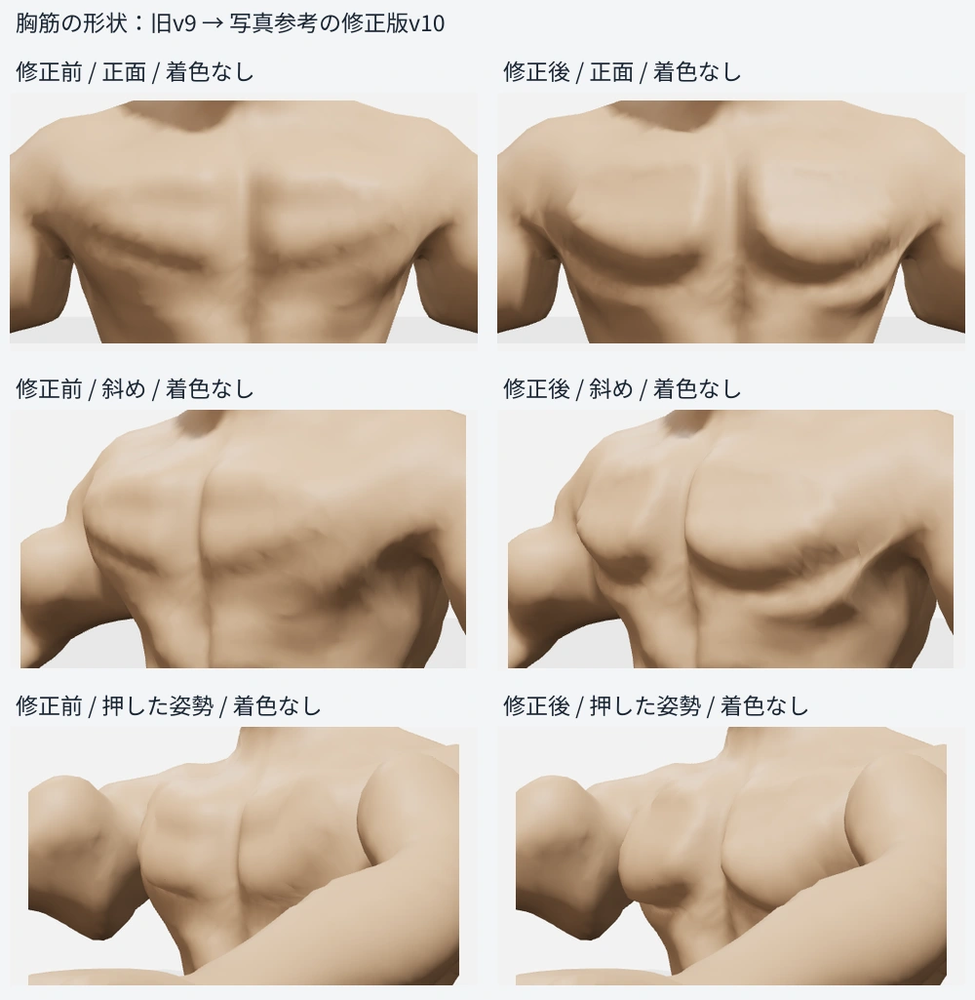

# 写真を基準にした胸筋の形状修正（TASK-053 再修正）

2026-11-18、日本時間。起点は `9345aba`。ユーザーからv9の胸筋形状が不自然と再指摘され、正面写真を再提示された。TASK-053を引き続き再修正し、新しいタスクは起票しない。

## 写真に合わせる形

- 鎖骨の下から広がる、連続した大胸筋の面。
- 中央の縦の溝と、胸骨側の付着位置。
- 下縁は筋腹の中央で丸く下がり、内側の端と脇側で上がる。
- 胸から肋骨・肩へ自然に薄くつながり、棚状の下縁や下垂した二つの塊を作らない。

上部と中下部は一つの大胸筋内の領域として扱い、別の筋肉を貼ったような表現にしない。写真の輪郭・厚みの分布を参照し、人物の顔や写真テクスチャをモデルに貼り付ける変更はしていない。

## 実モデルの比較



左：v9、右：`photo-pectoral-fan-v10`。実際のアプリと同じ人体・スキニング・描画処理を使い、着色OFF、器具非表示で撮影した検査画像。同じ照明・材質・カメラ・切り抜き範囲を使用し、形状の画像加工はしていない。上2段はモデルの基準姿勢、下段はチェストプレス終点。写真の腕を下ろした姿勢とモデルの基準姿勢は異なるため、写真そのものと一致するという判定はしない。正規Expoアプリ画面でも別途確認する。

## 実装と保持

`shape_pectoral_fan` が胸前面の深さを再構成する。丸い筋腹の頂点を中央幅では低く、内側端・脇側では高くし、楕円状の胸郭へつなぐ。胸骨中央の元の形状を固定し、中央の帯を膨らませた結果として下に穴ができる問題を避ける。パッチ境界は深さだけを4組の平滑化で整える。

生成処理は衣服の接点を決めた後に胸を修正する。胸から遠い衣服頂点で同距離の候補がある場合にも、胸の形状変更がその候補選択へ影響しないようにする。

`pectoral_borders` を形状と胸の着色範囲で共用し、色が胸骨側の筋端より下にはみ出したり、下縁の筋腹を塗り残したりしないようにする。胸・上胸部と隣接する二頭筋/肩前部/肩側部の学習マスクを再計算。残り12マスクはバイト一致する。

以下はv9からバイト一致する。

- 全頂点のX/Y座標、胸前面とその境界以外の頂点位置。
- 24,000頂点 / 47,910三角形、1人体メッシュ、インデックス・材料分類。
- 22骨・基準骨格、全スキンインデックス/ウェイト、握り・衣服の接点。
- 元の23 CC0入力と固定コミット。

法線・AOを再生成し、シェーダーキャッシュの識別子をv10へ更新する。照明・材質・収縮変形の係数・筋繊維ガイド・種目軌道・保存・言語・ズームは変更しない。新規依存・メッシュ・時計・保存項目なし。

## テストと再現

新規 `pectoralShape.test.ts` は次の5項目を、色や陰影によらず実三角形で検証する。

1. トポロジー/骨/ウェイト/握り/衣服接点と全X/Y座標の保全。
2. 胸骨中央と胸前面以外の頂点位置の保全。
3. 各筋腹の中央が低く、内側・外側の端が高い丸い輪郭。
4. 縦断面に急な棚状の傾斜を作らないこと。
5. 左右の筋腹と、深くなりすぎない中央の溝。

既存の筋量/部位配置/握り/衣服/ベンチ/収縮線の条件を保持する。意図した形状・法線・隣接マスクの変更に伴う固定ダイジェストとprofileのみ更新する。既存テストの許容範囲は緩めない。

```bash
python mobile/scripts/build-human-model.py --source-root /path/to/makehuman --output /tmp/pectoral-v10.json
cmp /tmp/pectoral-v10.json mobile/src/data/human/makehuman.json
python mobile/scripts/human_pectoral_masks.py --check
```

MakeHuman固定コミット：`a8bc2d54ff0ac92e78ff71431b1023eda42bf482`。Python/NumPyが必要。

## 最終検証結果

- Jest：全64スイート / 777テスト合格（既存772＋新規5、417.346秒）。
- TypeScript型検査・release:check（日英2,032組/静的759呼出）合格。
- iOS/Android Hermesローカルバンドル各約6.5MBを生成。署名ビルド・配布ではない。
- 固定入力からのモデル再生成がバイト一致、胸マスクの再計算一致。
- 正規Expoアプリ：胸8種目×日英（390/320幅）×開始/終点×6方向＝192表示、実行エラー0。着色ON/OFF往復一致、図解切替、横はみ出しなし。
- 正規Expo画面でもチェストプレスの着色OFF・開始/終点を撮影し、検証対象のsourceHashと一致、実行エラー0を確認。
- 同じ描画処理の着色OFF検査：変更前後各51状態（基準姿勢＋胸8種目の開始/終点・正面/斜め/横）、実行エラー0。

表示の検証対象とアプリのsourceHash：`4991374bfb2ababfa4bea2080dbec415cd3a91d0bd6eb81da5d9a38cf64045f9`。

状態は **IN REVIEW**。旧v9のLGTM記録（`60caa39`）は同期履歴として保全し、ユーザーの新しい写真による修正要求を優先する。v9の合格を今回のv10の見た目の合格へ流用しない。

## 再レビュー

最新mainを取得し、旧プレビューを停止してから実行する。

```bash
cd mobile
npm run preview:app -- --port 3000
```

`/app-preview/?lang=ja` と `?lang=en` で初心者のフォームガイドを開く。胸の8種目、着色OFF/ON、開始/中間/終点、正面/斜め/横/上方で、写真にある丸い下縁・中央の溝・脇への移行を見比べる。50%縮小と近接表示、器具との握りも確認する。

技術検証の合格と、写真を基準にした見た目の受入は分ける。胸筋の輪郭が不自然なら **Changes Requested** とする。iPhoneの描画速度・発熱は未確認。TestFlight、新規EAS/署名ビルド、外部配布は実行しない。TASK-017/018・他タスクには進めない。
