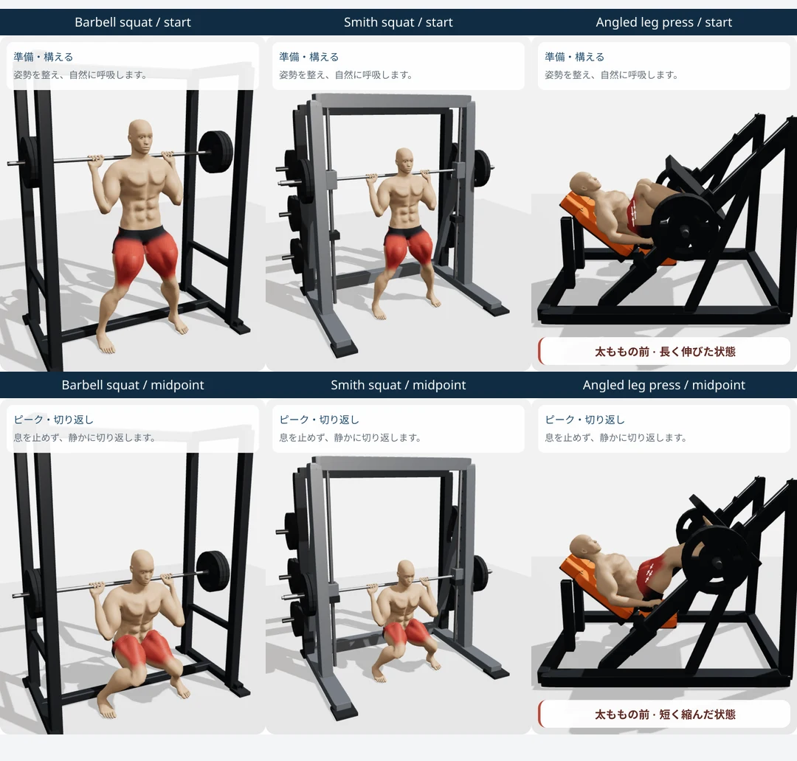

# 写真の脚マシン・スクワット肘位置 — TASK-068

2026-11-24（日本時間）。対象は `mobile/` のiOS / Androidアプリ。**IN REVIEW**。写真は形状の参考で、メーカーの実測CADモデルではない。

## 写真から反映した形状と動き

| 対象 | 固定する部分 | 動かす部分 |
| --- | --- | --- |
| スミススクワット | 銀色の幅広い前角柱、クロームガイド、黒い後柱、プレート収納、安全ストッパー、床脚 | バー、左右スリーブ、キャリッジ、装着プレートが鉛直方向へ一体移動 |
| 斜めレッグプレス | オレンジの座席・40度の背もたれ/頭パッド、黒い角フレーム、45度の二本ガイド | 大きな足台、左右の軸受、装着プレート/軸が同一方向・同一移動量で移動 |

レッグプレスは写真の斜めタイプを初期選択にする。座位タイプも選択でき、既存の座席スライド機構を維持する。足台の法線と足裏の接点を保ち、脚の二骨長を変えずに動く。座席横の握りをフレームへ接続し、スキンの手と接触する。追加のオレンジパッド材質は3DとSVGフォールバックに対応し、透過切替と破棄処理も既存方式に従う。

## 両スクワットの肘

通常のスクワットとスミススクワットで、肘を握り位置の下にそろえる。前腕とバー長軸の内積を0にし、正面で外へ開く肘を修正する。手幅も合わせ、既存の上腕長12.8・前腕から握りまで17.3を保つ二円交点の拘束解を使う。

バーと直角であることと、横から見た世界座標の完全な鉛直は区別する。自然な前後傾きを残し、骨を伸ばしたり肩を壊して鉛直を強制しない。手/指の資産は変更せず、実際のバー接点と金属径に対応した既存把持を継続する。教材の日英の「手」説明も更新する。

## 確認方法

1. 正規Expoプレビュー `/app-preview/?lang=ja` または `?lang=en` を開く。
2. 探索画面の脚コースからスクワット/スミススクワット/レッグプレスを選択する。
3. 模型直下の手動バーを0%→50%→100%へ動かし、前/横/後/上の視点で見る。スミスでは固定の収納プレートと可動するバープレートを区別する。
4. レッグプレスは**横視点**で写真に近い背もたれ・背中・膝・足台の関係を確認。台車が上がっても座席が動かないこと、座位式へ切替できることを確認。
5. お手本再生/停止・低速・手動操作と既存の記録入力を確認する。

## 検証結果と限界

- 最終4スイート100件: `photoLegMachines`, `photoLegGuide`, `legLessons`, `spatialGuide`。
- 把持/胸の回帰2スイート48件: `humanGrip`, `chestInteractive`。合計関連6スイート148件。全体一括実行は未実施。
- 新規テストは41段階の前腕直角・肘位置・骨長、実スキン接点/把持クリアランス、固定収納/バー連動、固定座席/45度レール/台車一体移動を検証。全30種目の有限座標・直交座標系・フレーミングも既存検証で確認。
- TypeScript型検査、release:check（日英2,301組・795静的UI呼出）合格。iOS / Android Hermesのローカルバンドル生成合格。
- 正規Expoブラウザ表示: 日英×3種目×4方向×2姿勢=48状態、手動/再生停止、座位/斜め切替、英語の日本語不在を確認。実行エラー0。
- ソース指紋: `fd96bc3e69601dbd6bf9184151afe57f71f9b1e27e8250815e67e7e52ed8ad90`。

iPhone実機の表示/動作、署名ビルド、インストール更新は未検証。TestFlight・EAS・外部配布はユーザー指示により保留し、プレビュー更新を実機更新と案内しない。店舗の実設備/ブランド設置情報、保存スキーマ、記録IDは変更しない。
