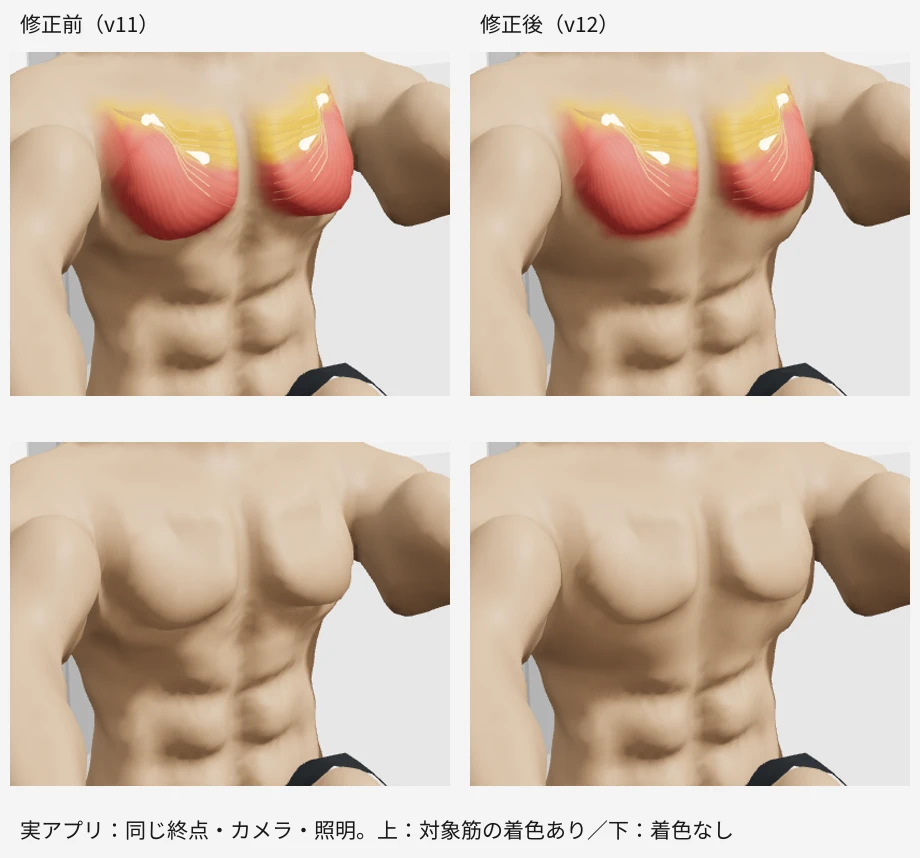

# 赤い胸筋の直下のくぼみを修正（TASK-053）

2026-11-18、日本時間。起点main `ea4a9dd`、モデルv11。前回の下縁の細かい凸凹の平滑化では、胸筋直下の胸郭が深く引っ込む形が残っていた。最新ユーザー指示に従い、TASK-053を再開してこの領域を修正した。上部・中部への評価は維持する。

左v11、右 `photo-subpectoral-bridge-v12`。正規Expoアプリのチェストプレス終点を同じカメラ・材質・照明・倍率で撮影。上段は赤い対象筋表示、下段は着色OFF。比較の切り抜き・配置以外に人物画像を加工していない。写真の人物そのものの再現や、見た目の受入完了は主張しない。

## 修正内容

`human_anatomy_surface.py` の `bridge_subpectoral_wall` で、胸筋下部と上腹部の実皮膚面をサンプリングし、外向きの滑らかな曲面でつないだ。元の皮膚より奥へ削らず、胸筋の下から腹部へ落ち込んでいた領域を埋める。下側の境界は上腹部の曲線に沿わせ、腹筋の形を残した。法線とAOも同じ領域で更新する。元のv11下縁フィットは従来の条件を保つ。

- 深さが変わる1,029頂点はすべて外向き。最大0.618754モデル単位。法線1,041頂点、AO448頂点を更新。
- 上部・中部（筋扇の高さの1/3以上）の位置・法線・AOはv11とバイト一致。修正領域外を含む保護対象22,798頂点もバイト一致。
- 全X/Y座標、24,000頂点/47,910三角形/1人体メッシュ、全トポロジー・材料・ウェイト・22骨・基準骨格・握り・衣服接点を維持。
- CC0入力23個と固定MakeHumanコミット `a8bc2d54ff0ac92e78ff71431b1023eda42bf482` を維持。

実際の動作終点では、従来の収縮強調が下端を胸郭から膨らませていた。このため `humanDefinition.ts` / `realisticHuman.ts` で、胸筋下端だけの変形倍率を0.15から滑らかに1へ戻す。高さ1/3以上の上部・中部は倍率1で、従来どおりの変形。胸以外の筋肉・骨格軌道・手の握りはそのまま。1回計算するCPU配列と既存変形ループ内の倍率計算を加えるが、新しいフレームループ・時計・描画ノード・保存項目は作らない。

## 回帰検証の範囲

`pectoralShape.test.ts` に静止2件・動作2件を追加。実皮膚三角形との交点で、胸筋下端と直下の壁の深さ差、中央の人工的なくぼみを検査する。プレス/フライ/ディップスの開始・中間・終点を検査し、下端の変形補正あり/なしで上部・中部の動作後頂点が完全一致することも確認する。

今回の依頼対象は前回の「狭い下縁」より広い上腹部移行領域。このため保護領域はv11の実データを基準に再定義し、形状/法線/学習マスクの意図した固定ダイジェストを更新した。旧保護範囲をそのまま維持したとは扱わない。既存の左右差・輪郭傾斜・法線ばらつきの許容値は緩めていない。最大深さ差などは描画品質の回帰指標であり、解剖学的正確さや実測筋活動/負荷ではない。

## 検証対象

アプリsourceHash：`7a149173505ab9ca2e1f29c126d70f6da30aeac904e89722f53339c03c0b5ae4`。

- 関連5スイート39テスト、TypeScript型検査、release:check合格。
- 固定入力からのモデル再生成バイト一致、胸マスク再計算一致。
- 正規Expo：胸8種目×日英（390/320幅）×開始/終点×6方向＝192表示、実行エラー0。着色ON/OFF往復一致、図解切替、横はみ出しなし。
- 着色OFFの検査モデル：変更前後各75状態（基準姿勢＋胸8種目の開始/中間/終点・正面/斜め/横）、エラー0。正規アプリの着色ON/OFF終点比較も別途撮影。
- iOS/Android Hermesローカルバンドル各約6.5MB成功。署名ビルド・配布ではない。
- 全64スイート783テスト合格（既存779＋新規4、426.801秒）。

## 再受入の手順

最新mainを取得し、旧プレビューを停止してから `cd mobile && npm run preview:app -- --port 3000` で再生成。`/app-preview/?lang=ja` と `?lang=en` の `preview-info.json` のsourceHashが上記と一致することを確認する。古いプレビューに今回の修正が届いたとは扱わない。

胸8種目の開始・途中・終点を正面/斜め/横/上方から、着色ON/OFF・低速・手動位置で確認する。赤い胸筋の下の大きなくぼみ、動作時の下端の浮き上がり、上部・中部の保全を重点レビューする。見た目は **IN REVIEW** で、テストだけでDONE/LGTMにしない。iPhoneの速度・発熱は未確認。TestFlight、新規EAS/署名ビルド、外部配布、他タスクは進めない。
