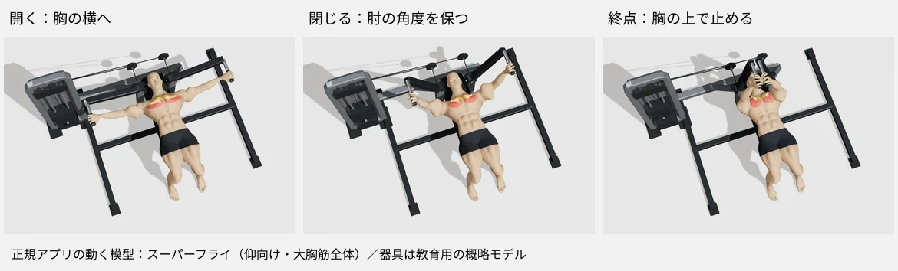

# スーパーフライ：仰向けで胸全体を狙う動くフォームガイド（TASK-055）

2026-11-19、日本時間。ユーザーの明示指示で追加。「ハンマーストレングス」「ペックフライを寝転んで行う種目」と本人確認済み。通常の座位ペックフライと区別した、アプリ本体 `mobile/` の新種目である。

正規Expoアプリの実際の3D描画を、同じカメラ・倍率で撮影した3場面。人物や器具の描画には画像加工をしていない。利用者が指定した「仰向けのマシンフライ」の支持・軌道を教育用模型へ反映したもの。メーカー公式CAD、実機の寸法、型番や抵抗機構の詳細とは未照合で、製品の正確な複製と称さない。

## アプリで追加したもの

- 胸コースは8→9種目、全体の模型ガイドは28→29種目。
- メニュー検索・胸フィルター・選択保存に `m-super-fly` を追加。専用ガイド `super-fly` を開く。既存のペックフライと種目・記録を混同しない。
- 大胸筋全体を狙う説明、姿勢・手・足・動作の初心者ステップ、狙い/意識/注意点/コツ、支持と開始位置の説明を日英で追加。胸の各部位への負荷が均等とは断定しない。
- 水平な固定ベンチ、固定された骨盤・肩・足、一定の肘の曲げ角度で胸の横から上へ閉じる専用3D動作。左右の機構とハンドルは同じ軌道に追従。握りは既存の指・手の接点処理を使う。
- 初期視点は上方。姿勢/手/動作は上方、足は側方。既存の6方向・自由回転・縮小拡大・停止・手動位置・コマ送り・通常/0.5/0.25倍再生を利用できる。
- 3Dを使えない時のSVG図解も同じ姿勢/器具座標から投影。ベンチ面は実際の水平面を描画する。
- 初心者の重量/回数/セット記録と本格専用の既存記録欄へ統合。本格モードには基本解説や筋収縮の理論を増やさず、負荷を受ける位置・戻しの制御・安全に次の組を軽くする助言を追加。

## 設備判定・保存の扱い

検索カタログの専用器具IDは `super-fly`、ブランドはユーザーが指定したハンマーストレングス。既存の `pec-fly` や `chest-press` から設置済みとは推定しない。既存サンプル店舗の設備は変更せず、専用設備が登録されている場合のみ実施可能と判定する。部位の検索区分は他の一般的な胸種目と同じ胸の区分、フォーム教材の狙いは大胸筋全体である。

新しいメニューIDは既存のsearch v1へ、記録名 `chest.superFly.name` は既存のfitness保存へ統合する。スキーマ変更や既存記録の書換えなし。日本語/英語切替でも記録IDは変わらない。写真AIや実測の筋活動/負荷を追加したものではない。

## 確認結果

- 関連4スイート40テスト合格（専用テスト5件を含む）。
- 型検査・release:check合格。日英2,076組、静的UI呼出759件の監査を通過。
- 正規Expo Web：日英×開始/中間/終点×6方向＝36表示、実行エラー0。0.25倍実再生・手動コマ送り・SVG切替・ベンチの面投影・英語への日本語混入なし・320/390幅の横はみ出しなしを確認。
- sourceHash: `a77023c08932b42fdefeb99cc0b257ea226670382c6a96e2e03498c8bdbd9b6a`。
- 全体65スイート803テストを実行（444.12秒）。64スイート802件が合格し、残る1件は既存画面テストの「全28種目」という旧期待値だけが不一致。アプリの表示は29で正しいためテスト期待値を29へ更新し、該当 `training.test.tsx` を再実行して4件全合格（3.254秒）。全体実行後の本体コード変更なし。全件の確認を完了し、単一の全体再実行で全緑だったとは記録しない。
- iOS/Android Hermesローカルバンドル各約6.5MB成功。署名付きアプリの生成や配布ではない。

## レビュー手順

最新mainを取得して旧プレビューを止め、`cd mobile && npm run preview:app -- --port 3000` でアプリコードを再生成。`/app-preview/?lang=ja` / `?lang=en` のmetadata sourceHashと上記を照合する。

1. メニュー → 胸、または検索「スーパーフライ」/「Super Fly」→ 種目を選択 → フォーム確認を開く。胸コース選択からも開ける。
2. 頭・背中・骨盤が水平ベンチに支えられ、足が固定され、肘を伸ばすプレスにならず弧を描くことを上方・側方から確認。
3. 低速・0.25倍・コマ送り・手動位置でハンドルと指の接点、開始・中間・閉じた位置・戻しを確認。既存のペックフライやベンチプレスも往復確認する。
4. 初心者で記録してマイページへ戻り、種目名・重量・回数・セットを確認。言語切替・再読み込み後も選択と記録が保持されることを確認する。本格記録との表示分離も確認する。

TASK-055は見た目と実動の **IN REVIEW** へ渡す。ブラウザ確認を実機インストール済みと扱わない。iPhone実機の速度/発熱/インストール・更新は未確認。TestFlight・新規EAS/署名ビルド・外部配布は実行しない。他タスクは進めない。
