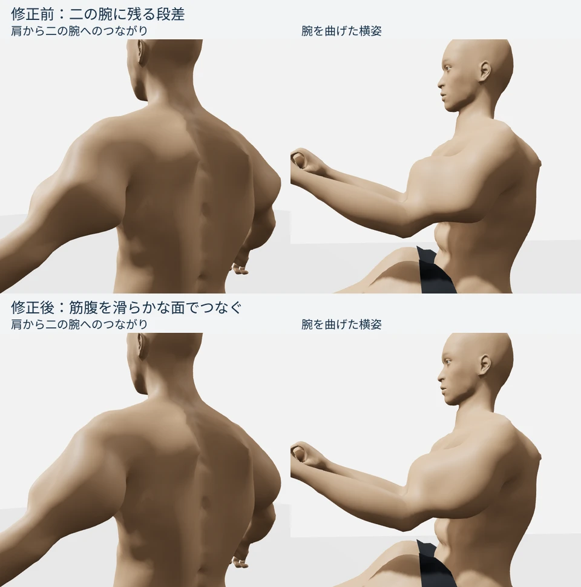
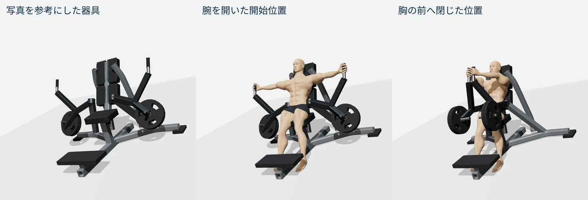

# TASK-059：二の腕の表面と写真のスーパーフライ（レビュー依頼）

アプリ本体`mobile/`の人体と器具を変更しました。二の腕に残っていた角ばった筋腹・細かな段差を整え、スーパーフライはユーザー提供写真の構成に合わせています。

上段は承認済みv13（main `b7ed778`）、下段はv14。同じ姿勢・カメラ・照明で、筋肉の着色を消して比較しています。上腕の大きな前後の筋腹を残し、肩から肘へ表面が滑らかにつながるよう調整しました。

写真の器具に合わせ、水平ベンチとウエイトスタックを、傾斜した分割背もたれ・独立座面・左右のプレート式アーム・前方の乗降ステップに変更しました。画像から見える構造と比率を再構成した模型です。内部機構や寸法はメーカーの設計図で照合していません。

## 二の腕

- `human_upper_arm.py`が、上腕の周囲と長さに沿った大きな筋腹の曲面を生成。肩とのつなぎ目を滑らかにし、陰影も同じ範囲で調整します。
- v13の修正範囲外22,692頂点は位置・法線・陰影のバイトが完全一致。胸・手の握り・肘端の輪郭・骨格・筋肉マスク・衣服・記録を維持。
- 上腕の代表範囲で、幾何学的な小さな段差の平均は左0.01323→0.01274、右0.01305→0.01250。隣接法線の変動も左0.03068→0.02141、右0.02894→0.02075に低下しました。
- 元座標のfixtureに基づき、筋腹の平均半径・補正量・面の向きを検査。三角形の反転0件。既存の肘半径と握りの固定基準も維持。
- 24,000頂点／47,910三角形／22骨／人体メッシュ1個。処理は生成時のみで、実行時のループ・テクスチャ・メッシュ追加はありません。

## 写真のスーパーフライ

- 左右二列・上下二段の独立した背もたれパッド、独立座面、支持フレーム、床の左右脚、前方ステップを造形。
- 左右のレバー、プレート・装着軸・留め具、軸受、長いグリップを配置。ウエイトスタックとケーブルは除去。
- 模型の背もたれは床から約60度。頭・背中・骨盤を支え、足裏を床へ。角度は画像から再構成するための模型設定で、実機の確定寸法や利用者への強制値ではありません。
- 手とレバーを同じ支点・軌道で計算し、左右のハンドルを握ったまま開閉。肘の軽い曲がりと腕の長さを維持。プレートもレバーと一体で動きます。
- 初期視点は正面。前・後・左右・上・下、自由回転・ズーム・低速再生・手動位置操作を維持。
- 軽量SVG表示も同じ3D座標を投影し、4枚のパッドを実際の傾斜面として描画。
- 日英の姿勢・開始位置・プレート確認・足位置・記録説明を同期。種目IDと保存方式は維持。ほかの胸種目の軌道は変更していません。

## Antigravityでの確認

1. 最新mainを取得し、`npm --prefix mobile run preview:app`で正規プレビューを再生成・再起動。
2. `http://localhost:3000/app-preview/?lang=ja`で初心者マシンガイドを開き、スーパーフライを選ぶ。
3. 正面・左右・後方・上方で、4枚のパッド、座面、フレーム、プレート、両手の握りと足の位置を確認。
4. 開始・中間・終了を手動で切り替え、0.25倍再生。背中と骨盤が支持面に留まり、ハンドル・レバー・プレートが連動することを確認。
5. アームカールマシンも選び、着色ON/OFFで二の腕の輪郭を前・横・後から比較。
6. 軽量図解へ切り替え、パッドの傾斜と人体の位置が一致することを確認。`?lang=en`でも姿勢説明と操作を確認。

全69スイート/836テスト合格（既存828＋新規8、実行時`--testTimeout=15000`）。型検査・release:check・両OSローカルHermesバンドルも合格。見た目の最終受入とiPhone実機での表示・更新は確認待ちです。TestFlight・新規EAS／署名ビルド・配布は保留しています。

正規Expoプレビューは日英/390・320幅×2種目×着色ON/OFF×3姿勢×6方向＝144表示、0.25倍再生・手動位置・4パッドSVG表示を確認。実行エラー0。

sourceHash: `a4bb091a9a5933599e114e3383d1a22b9ffce75277e59d59ae15eb070e332f43`。[機械可読の証跡](evidence/upper-arm-photo-super-fly.json)
